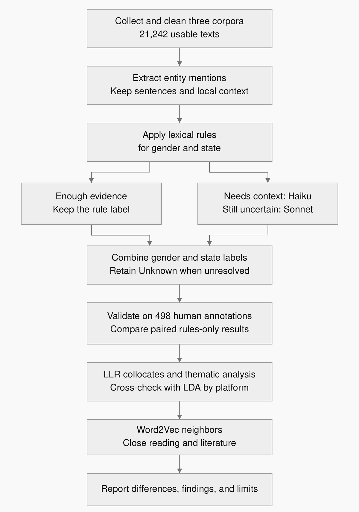
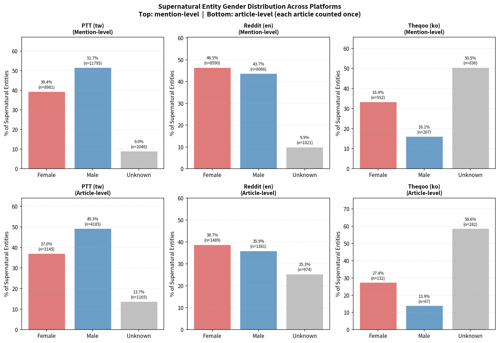
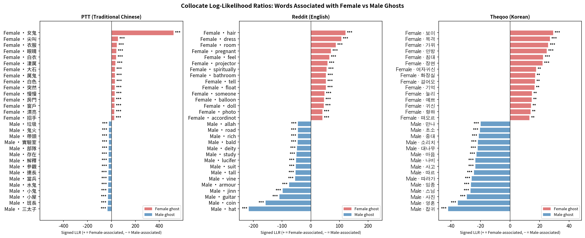

# Ghost Stories Are Never Just About the Dead

Master's thesis · Meng-Yu Chiu · KAIST Graduate School of Culture Technology · 2026

**Gender in Ghost Stories: An Analysis of 21,242 Texts Across Three Languages**

For my master's thesis at KAIST's Graduate School of Culture Technology, I analyzed ghost stories from PTT, TheQoo, and Reddit to study how ghosts of different genders are described. I built an analysis workflow combining lexical rules, LLMs, and human validation. On 498 manually annotated entity mentions, gender classification reached a Macro-F1 of **0.94**.

[Notion portfolio: 中文 / English](https://app.notion.com/p/1bdfea401f5a81829bd0dd489be61d51)

## 1. Research Questions

While reading ghost stories from different places, I noticed recurring descriptions: white clothing, long hair, bedrooms, and military settings. I wanted to understand **whether female and male ghosts appear in different settings and are described through different appearances and actions—and whether these differences recur across platforms in different languages**.

I broke the question down into ghost gender distribution, space, color, and haunting methods, then used text analysis to examine these narrative patterns. The research first required distinguishing human characters from supernatural presences before examining the relationship between gender and storytelling.

## 2. My Role and Responsibilities

Under the supervision of Prof. Juyong Park, I was responsible for the research design, corpus collection and cleaning, multilingual classification workflow, manual annotation, statistical analysis, figures, and thesis writing. I used Claude and Claude Code to assist with implementation; I was responsible for the research questions, classification definitions, human annotations, and interpretation.

The project required working with both texts and numbers. I translated concepts from cultural research into variables that could be labeled and compared, then returned to the stories and literature to assess which interpretations the statistical results could support.

## 3. Data

I collected **22,393 public posts** and retained **21,242 usable texts** after removing posts without body text.

| Platform / language | Selection and collection method | Collected posts | Usable texts |
| --- | --- | --- | --- |
| PTT / Traditional Chinese | Marvel posts with “experience” in the title; BeautifulSoup4 | 15,759 | 14,610 |
| TheQoo / Korean | The horror board's “real experience” category; Selenium | 967 | 965 |
| Reddit / English | Text content from r/Paranormal and r/Ghoststories; PRAW API | 5,667 | 5,667 |

Classification uses **entity mentions**: individual occurrences of a human character or supernatural presence, with the sentence and nearby context. One story can produce several records. The human validation set contains 498 mentions, with 166 from each platform, covering cases the rules labeled Female, Male, and Unknown.

The platforms cover different periods and user populations, and Reddit is not a direct sample of the US population. The results therefore describe narrative patterns in these platform corpora.

## 4. Tools and Outputs

| Tool | Role and output |
| --- | --- |
| Python, BeautifulSoup4, Selenium, PRAW | Collect and organize texts, segment sentences, extract entity mentions, and produce analytical data and figures |
| jieba, Kiwi, spaCy | Tokenize each language and filter parts of speech to prepare words for collocate analysis |
| Claude API | Classify cases the rules cannot resolve, recording labels, evidence, and confidence indicators |
| gensim | Build separate LDA and Word2Vec models for each platform; export topic words and semantic neighbors |
| R | Conduct formal classifier evaluation, statistical tests, effect-size and confidence-interval calculations, and prepare thesis result tables |

## 5. Analysis Process



Classification covers two tasks: gender (Female, Male, Unknown) and state (Alive, Deceased, Supernatural, Unknown). Rules handle cases with explicit lexical cues. Cases requiring context go to Claude Haiku, with Sonnet as a fallback when uncertainty remains. Cases without enough evidence retain the Unknown label.

After classification and validation, I used log-likelihood ratio (LLR) analysis to identify words that occur disproportionately in female- or male-ghost contexts, then organized them into space, color, and haunting-method themes. LDA provided a cross-check on the themes; Word2Vec and close reading helped interpret what the words meant within the stories.

## 6. Key Findings

### ① Adding an LLM improved gender classification, while performance differed by task

I compared rules alone with the rules-plus-LLM workflow on the same 498 human-annotated mentions.

| Classification task | Rules-only Macro-F1 | Rules + LLM Macro-F1 | Rules + LLM Cohen’s κ |
| --- | --- | --- | --- |
| Gender: Female, Male, Unknown | 0.88 | **0.94** | 0.93 |
| State: Alive, Deceased, Supernatural, Unknown | 0.45 | **0.65** | 0.54 |

For gender, the cascade corrected 36 errors made by the rules, while introducing errors in 6 cases the rules had classified correctly. A paired exact McNemar test found a significant difference between the workflows (p < .001). This gave me direct evidence of what adding the LLM contributed.

Macro-F1 averages the F1 scores across classes, including Unknown. These results measure classification performance on sampled mentions; they do not mean that 94% of complete stories were classified correctly. State classification remained weaker, which limits the interpretations built on it.

### ② Ghost gender distribution differed across platforms, with a small effect size

Among supernatural entity mentions, male ghosts accounted for 51.7% on PTT, compared with 39.4% for female ghosts. On Reddit, female ghosts accounted for 46.5%, slightly above 43.7% for male ghosts. Female mentions also outnumbered male mentions on TheQoo, but **50.5% of mentions had an unknown gender**.

After excluding Unknown, the association between platform and ghost gender was significant under both mention and article counting, but Cramér’s V was about **0.10**, indicating a small effect. I interpreted this as a difference within the platform corpora, using texts and literature on subjects such as military ghost stories to discuss possible cultural contexts.



The top row counts mentions. The bottom row counts each article at most once per gender category. An article can contribute to several categories, so the bottom-row percentages do not represent mutually exclusive groups of articles.

### ③ Gender differences also appeared in settings and descriptions, with variation across platforms

LLR collocates revealed differences beyond the gender proportions. On PTT, female-ghost contexts included “white clothing” and “screaming,” while male-ghost contexts included “squad leader,” “military service,” and “company commander.” On TheQoo, female contexts included bedrooms, beds, and sleep-related terms, while male contexts included monks and spirits. I then compared whether themes appeared within articles to examine how these word associations extended to settings and actions.

| Dimension | Findings and scope of interpretation |
| --- | --- |
| Indoor / domestic space | Associated with female ghosts on TheQoo and Reddit at conventional significance levels; PTT showed the same direction, but p = .0557 did not meet the .05 threshold |
| Military settings | More clearly associated with male ghosts on PTT; this does not establish the same pattern on all three platforms |
| White and sound | Both associated with female ghosts on PTT and Reddit; the corresponding TheQoo comparisons were not significant |



The bars show relative association with female- or male-ghost contexts, rather than raw word counts. Collocate significance in this figure uses BH-FDR correction for multiple comparisons. The thematic comparisons are reported separately in the thesis's article-level result tables.

These findings allowed me to discuss gender roles through specific settings and descriptions. Migration history, military experience, and religious ideas provide interpretive contexts in the thesis; the statistical analyses do not directly establish them as causes.

## 7. Challenges and Lessons

### Define the target before choosing a classification method

A passing reference to a deceased grandmother needs a different state label from a grandmother returning to speak with her family. Similarly, the Taiwanese expression “good brothers” can refer to ghosts without specifying gender. I incorporated these distinctions into category definitions, lexical rules, and prompts, and retained Unknown when evidence was insufficient. State classification's Macro-F1 of 0.65 also made the limits that classification quality places on later interpretation clear.

### Establish a checkable standard for automated labels

Another set of automated labels can show whether systems agree, but cannot directly establish correctness. I therefore drew a stratified sample, annotated the mentions myself, and compared both workflows on the same examples, including Unknown. Sonnet labeled another 498 mentions as a supplementary comparison; human annotation remained the primary reference. For collocate analysis, I also added stopwords such as pronouns and kinship terms to reduce the risk of merely repeating gender references.

### Check the denominator when comparing corpora of different sizes

PTT contained 14,610 usable texts and TheQoo only 965, so raw frequency comparisons could reflect corpus size. I examined both mention and article counts, compared theme presence as a share of articles associated with each gender, and reported effect sizes. This helped distinguish statistical significance from a large difference, while keeping TheQoo's smaller sample and high Unknown share in view.

### Return words and model outputs to their narrative context

LLR identifies associated words, but a word list alone cannot explain their meaning in a story. I used Word2Vec neighbors, close reading, and the literature to develop that interpretation. LDA supported some space and haunting-method themes, while color did not consistently form a dominant topic. Interpretation of color therefore relied more on textual examples and prior research. I kept track of what each method could support and adjusted the strength of the argument accordingly.

## Repository Guide

The repository contains research notebooks and selected thesis figures. The raw posts, completed human annotations, intermediate CSVs, trained models, and thesis PDF are not included.

| File | Role in the research |
| --- | --- |
| [02_gender_ghost_analysis.ipynb](notebooks/02_gender_ghost_analysis.ipynb) | Load texts, extract mentions, apply rules and LLM fallbacks, export annotations and collocates; also contains exploratory analyses |
| [01_haunted_space_gender_distribution.ipynb](notebooks/01_haunted_space_gender_distribution.ipynb) | Space, color, and haunting-method comparisons, article-level presence checks, and text retrieval for close reading |
| [03_topic_modeling.ipynb](notebooks/03_topic_modeling.ipynb) | Separate LDA models for each platform and cross-platform topic-to-theme mapping |
| [04_word2vec_LLR_thematic.ipynb](notebooks/04_word2vec_LLR_thematic.ipynb) | Separate Word2Vec models, thematic keyword neighborhoods, vocabulary coverage, and semantic comparisons |
| [05_statistical_analysis.Rmd](notebooks/05_statistical_analysis.Rmd) | Formal classification evaluation, paired comparisons, confidence intervals, and thesis statistical tables |

## Methods and Reported Results

The results below are reported in the 2026 thesis, *Ghost Stories Are Never Just About the Dead: A Cross-Cultural NLP Analysis of Gendered Narrative Patterns*, by Meng-Yu Chiu, supervised by Prof. Juyong Park at KAIST. The corpus counts come from Chapter 3.1; annotation counts from Tables 3.3–3.4; classifier metrics from Tables 4.1–4.5; platform comparisons from Table 4.6; thematic findings from Tables 4.10–4.12.

### Classification and validation

- Classification operates on mentions with local context, not on complete stories or uniquely identified individuals. Gender has three labels: Female, Male, Unknown. State has four: Alive, Deceased, Supernatural, Unknown.
- Rules handle explicit cues. Unresolved cases go to Claude Haiku, followed by Sonnet when the answer is Unknown or confidence is low. The implementation retains method, confidence, and evidence fields. Notebook prompts use local context with character limits in the API helpers.
- The human reference contains 498 mentions: 166 per platform. Sampling was stratified using rule-based gender labels. It is a validation sample, not a population-weighted estimate of corpus-wide accuracy.
- Formal evaluation includes Unknown as a class. Earlier exploratory evaluation cells in notebook 02 use narrower label subsets; the full-label evaluation is implemented in the R Markdown file.

| Task | Method | Macro-F1 | Bootstrap 95% CI | Cohen's κ |
| --- | --- | --- | --- | --- |
| Gender | Rules only | 0.8846 | 0.8534–0.9107 | 0.8331 |
| Gender | Cascade | 0.9397 | 0.9138–0.9615 | 0.9266 |
| State | Rules only | 0.4503 | 0.3947–0.5064 | 0.3787 |
| State | Cascade | 0.6546 | 0.5519–0.7288 | 0.5371 |

The exact McNemar comparison uses paired predictions on the human reference: gender b = 36, c = 6; state b = 58, c = 0; both p < .001. Here, b counts errors corrected by the cascade and c counts new errors introduced by it. A zero c does not mean the classifier made no errors overall.

A separate 498-mention Sonnet reference provides a supplementary comparison: gender Macro-F1 0.8505, κ 0.8773; state Macro-F1 0.4796, κ 0.3347. It complements human annotation and does not replace it. The cascade and supplementary annotator both use models from the Claude family.

### Narrative analysis

- LLR compares content words around female and male supernatural mentions, with language-specific tokenization, stopword filtering, and BH-FDR correction for collocate tests. Pronouns and kinship references are filtered to reduce direct gender-reference effects; domain-specific ghost terms remain visible in the published figure.
- Thematic comparisons use article-level presence of space, color, and haunting-method keywords. The thematic p-values cited above are the individual tests reported in thesis Tables 4.10–4.12; the LLR figure's BH-FDR qualification does not describe those separate tests.
- LDA models were fitted separately for PTT (10 topics), TheQoo (8), and Reddit (7). They provide a cross-check using the same corpora, not a held-out validation set. Color did not consistently emerge as a dominant topic, so its interpretation also uses close reading and prior literature.
- Word2Vec was trained separately for each platform using skip-gram, 200 dimensions, window 5, minimum count 3, and 10 epochs. The models provide semantic neighborhoods within each corpus; they do not create a shared aligned embedding space across languages.
- The retained gender-distribution figure shows both mention counts and counts deduplicated by article and gender. Its article percentages use the sum of category counts as the denominator. An article can contribute to several categories.

## Working With the Notebooks

These are research notebooks with local and Google Colab/Drive paths. To run them, configure their input and output paths and provide the text and intermediate files expected by each notebook.

1. Install the core Python packages:

   ```bash
   python -m pip install -r requirements.txt
   jupyter lab notebooks/
   ```

   Additional packages, language resources, fonts, and R dependencies are declared in the individual setup/import cells. `requirements.txt` covers the core Python stack, not every dependency used in every exploratory cell. The R file lists its required packages at the top.

2. Start with notebook 02 to review raw-text paths, mention extraction, classification settings, and annotation export. Provide `ANTHROPIC_API_KEY` through the environment to use Claude, then review the configured backend and model names. The shown configuration reads the environment variable; it does not automatically load a `.env` file.

3. Complete the exported human annotation task and provide the completed annotation and method-mapping files for formal evaluation. These labels are not supplied in this repository.

4. Use notebook 01 for thematic comparisons, 03 for LDA, and 04 for Word2Vec. Review their input dependencies before execution, then use the R Markdown file for formal evaluation and result tables.

With the LLM backend disabled or unavailable, the configured workflow can fall back to rules. That produces a different classification condition from the reported cascade results.

## License

Code is released under the MIT License; see [LICENSE](LICENSE). Forum texts remain subject to their authors' rights and the platforms' terms, and are not redistributed here.
